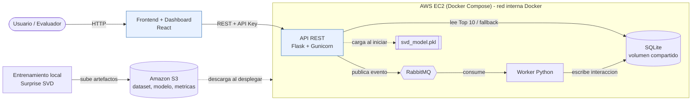
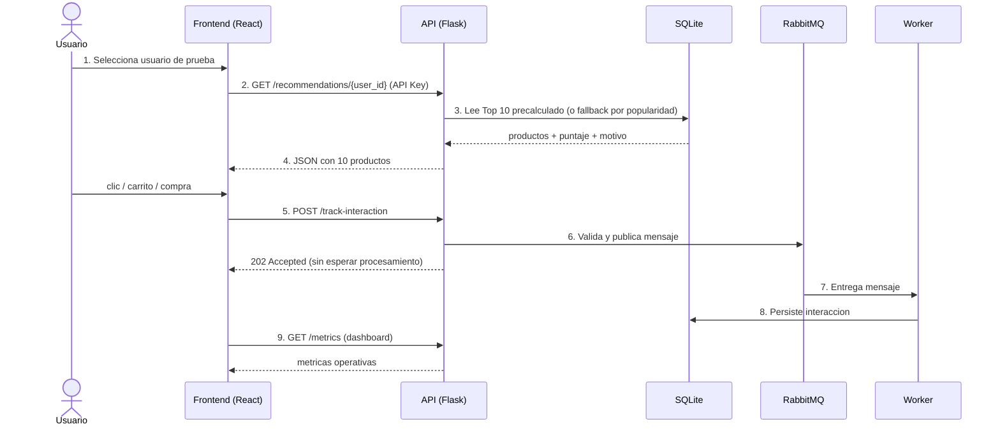

# Figuras 8 y 9 (Mermaid)

Pega cada bloque en https://mermaid.live , exporta como PNG/SVG e insértalo en el informe.

## Figura 8. Arquitectura del prototipo (Tabla 14)

Solo el frontend y la API son accesibles desde Internet; RabbitMQ y SQLite quedan en la red interna.

## Figura 9. Diagrama de secuencia (Tabla 15)

